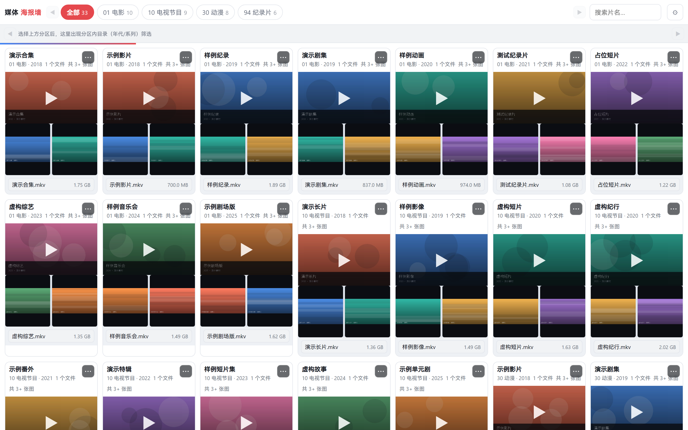
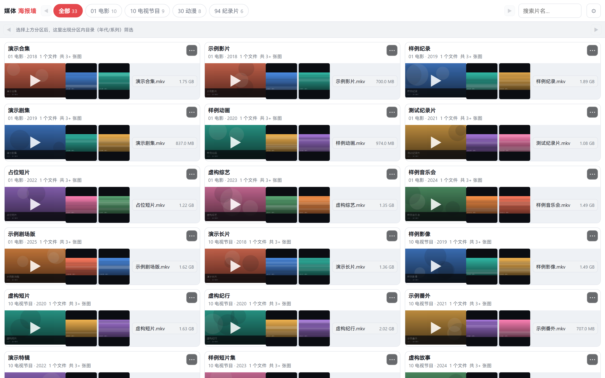
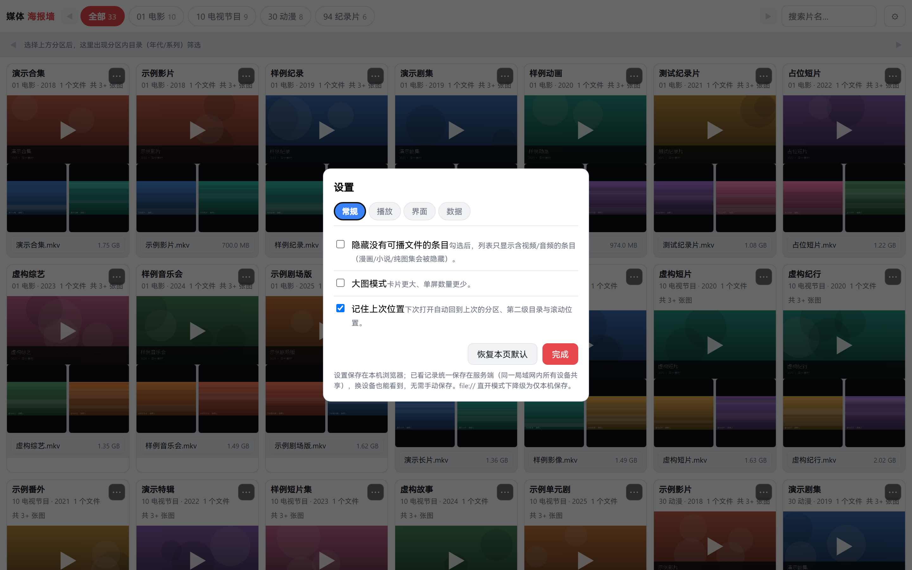
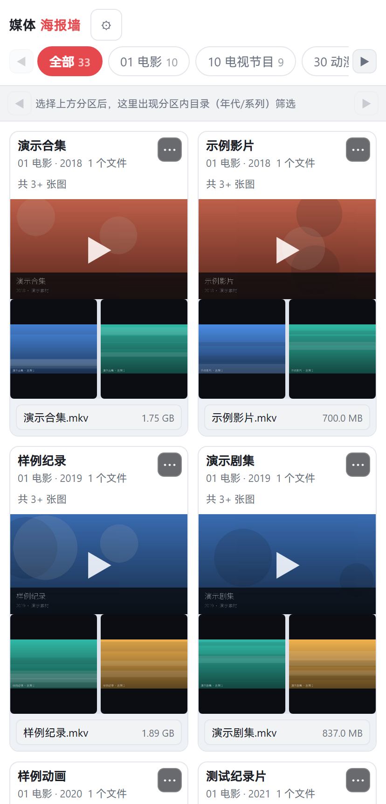
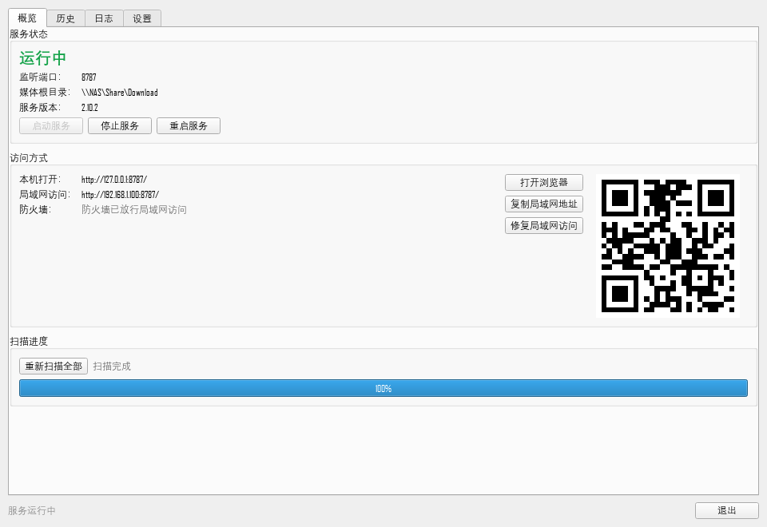
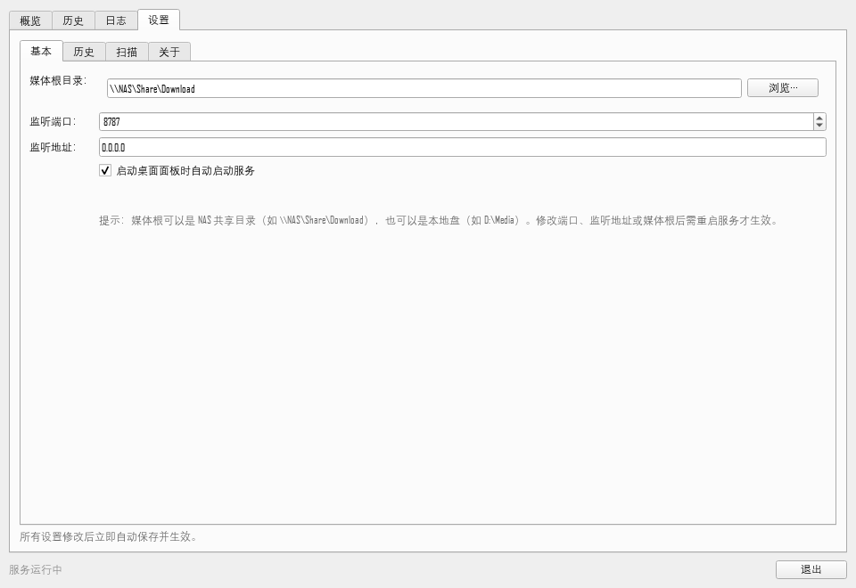

# Media_Wall · 多分区媒体海报墙

由 `AV_Wall` v1.9.0 泛化的 NAS 媒体海报墙：管理你的媒体根（示例 `\\NAS\Share\Download`，
也可以是本地盘如 `D:\Media`）下的
**多个分区目录**（01 电影 / 10 电视节目 / 20 综艺 / 30 动漫 / … / 99 其他），
网页端两级选择——先点分区标签，再点分区内目录（年代/系列）筛选，下面是与
AV_Wall 相同的海报墙、在线播放（Range 流 + 观看进度）与局域网扫码访问。

**三句话说清**：它是一个**跑在你电脑上的私人影视库网页**，媒体文件放哪都行（本地盘或 NAS），
启动后电脑、手机、平板、电视盒子都能用浏览器翻海报墙并直接播放。
适合「有一堆按目录堆着的片子、又不想装 Plex/Emby 那套重型服务」的人。

## 目录

- [界面预览](#界面预览)
- [零基础入门：从拿到文件到看上片](#零基础入门从拿到文件到看上片)
- [三个真实使用场景](#三个真实使用场景)
- [快速开始（源码模式）](#快速开始源码模式)
- [配置（config.json，实时自动保存）](#配置configjson实时自动保存)
- [配置文件详解](#配置文件详解)
- [目录结构](#目录结构)
- [编译成 exe](#编译成-exe)
- [局域网访问（v2.10.2 重写取址逻辑 + 防火墙自检）](#局域网访问v2102-重写取址逻辑--防火墙自检)
- [工作原理（技术参考）](#工作原理技术参考)
- [排错手册（按现象查）](#排错手册按现象查)
- [FAQ（常见问题）](#faq常见问题)
- [已知限制与安全说明](#已知限制与安全说明)
- [版本更新简介](#版本更新简介)
- [开发、构建与回归测试](#开发构建与回归测试)
- [贡献与许可](#贡献与许可)

## 界面预览

下面这几张都是**真实运行截图**，但媒体库是程序生成的占位素材（片名全是「示例影片」
这种假名字），不是任何人的真实收藏。

### 网页端海报墙

电脑浏览器打开 `http://127.0.0.1:8787/` 看到的主界面。顶部是分区标签（带条目数），
每张卡片显示片名、分区与年份、文件数与剧照数，封面即播放入口：



### 大图模式

设置里勾上「大图模式」后，卡片变成横向三格：左边封面、中间两张剧照、右边文件名与体积，
一屏能看清一个作品的骨架。适合客厅电视或大屏：



### 网页设置面板

设置分「常规 / 播放 / 界面 / 数据」四页，改完即生效并自动保存，不需要点保存按钮：



### 手机端

手机浏览器访问同一地址，顶栏自动折成两行，目录条独占一行、左右可滑。
竖屏下卡片一行两张：



### 服务控制页

`http://<你的IP>:8787/server.html`，服务没起来也能用（走看门狗端口）。
提供启动/重启/停止三个按钮和手机扫码入口：


### 桌面控制面板（PySide6）

双击 `Media_Wall.exe` 打开的窗口。上半是服务状态与访问方式（含二维码），
下半是扫描进度；「防火墙」一行会自检局域网是否被拦：



设置页可改媒体根、监听端口与地址，改完立刻落盘：



> 截图怎么来的：`_scaffold/_make_screenshot_library.py` 生成假媒体库并扫出
> `library.json`，`_scaffold/_capture_screenshots.py` 用 Edge 无头 + CDP 截网页端、
> 用 PySide6 离屏模式截控制面板。两个脚本只写 `_screenshot_work/` 和
> `docs/screenshots/`，不碰真实 `data/` 与真实媒体目录。控制面板截图里的局域网 IP
> 与媒体根都换成了演示值（`192.168.1.100` / `\\NAS\Share\Download`），避免把本机
> 内网信息带进公开仓库。

## 零基础入门：从拿到文件到看上片

这一节假设你**完全不懂编程**，照着点就行。全程不需要打开命令行。

### 第 1 步：拿到程序

去 [Releases 页面](https://github.com/duma520/Media_Wall/releases/latest) 下载最新的
`Media_Wall-v2.10.2.zip`，右键「全部解压缩」到你想放的位置，例如 `D:\Tools\Media_Wall\`。

解压出来应该是一个文件夹 `Media_Wall-v2.10.2`，里面有 `Media_Wall.exe`。
**整个文件夹都要留着**——exe 旁边的 `.dll`、`PySide6\`、`index.html` 都是运行必需的，
只把 exe 单独拖出来会打不开。

### 第 2 步：整理你的媒体目录

程序不挑格式，只挑**目录结构**。它把「媒体根下面的每个一级子目录」当成一个**分区**
（相当于电视台的频道），分区里的每个「装了视频的文件夹」当成一张**海报卡片**。

所以你的目录应该长这样：

```
D:\Media\                      ← 这就是「媒体根」，第 3 步要填这个
    ├ 01 电影\                  ← 一个分区
    │   ├ 1999\
    │   │   └ 示例影片\
    │   │       ├ 示例影片.mkv   ← 有视频，这一层就成了一张卡片
    │   │       └ poster.jpg     ← 同目录的图会自动当海报
    │   └ 2020\
    ├ 20 综艺\                  ← 另一个分区
    └ 99 其他\
```

要点：
- **分区名字随便起**，程序会自动发现，不需要在配置文件里登记。
- **海报图**：卡片对应目录里的第一张图（按修改时间排序）自动当封面；多张图会进「剧照」。
- 也可以直接用 NAS 共享目录，比如 `\\NAS\Share\Download`。

### 第 3 步：第一次启动并设置媒体根

1. 双击 `Media_Wall.exe`，会弹出「Media_Wall 控制面板」窗口。
2. 点顶部的 **「设置」** 标签 → **「基本」** 子页。
3. 看到「媒体根目录」输入框，把第 2 步那个路径填进去（或点右边的「浏览...」按钮选目录）。
4. **不需要点保存**——程序改完立刻自动存盘。但**改完要重启服务才生效**：
   回「概览」页，点 **「重启服务」**。

### 第 4 步：第一次扫描

首次启动会自动开始全量扫描，概览页的「扫描进度」条会走。规模参考：16 个分区、
2000 多个条目、约 1.8 万个可播文件，实测约 1.5~3.5 分钟（取决于 NAS 速度）。

扫描完成后状态会显示「扫描完成」。

> 为什么第一次慢：要给每个条目找海报、统计视频数量、写缓存。
> 之后再有新增，走增量扫描，只处理变化的目录，通常几秒到几十秒。

### 第 5 步：看片

1. 回「概览」页，点「本机打开」右边的 **「打开浏览器」**，会打开
   `http://127.0.0.1:8787/`。
2. 页面顶部是一排**分区标签**，点一个（比如「01 电影」）。
3. 下面出现**子目录条**（年代/系列），点一个筛选；不点就是全部。
4. 海报墙上点任意一张卡片 → 弹窗播放。

### 第 6 步：手机上也能看

1. 手机连**同一个 Wi-Fi**。
2. 概览页「局域网访问」那一行有网址和二维码，手机扫码，或手输网址。
3. 打不开就看「防火墙：」那一行：
   - 灰字「防火墙已放行」→ 正常。
   - **红字「检测到阻止规则」** → 点右边的「修复局域网访问」，在 UAC 窗口点「是」，
     等五六秒红字变灰字，手机刷新即可。

---

## 三个真实使用场景

### 场景一：最简单——本机自己看

> 只有一台电脑，片子在 D 盘，不想折腾。

1. 双击 `Media_Wall.exe`
2. 设置 → 基本 → 媒体根填 `D:\Media` → 概览页点「重启服务」
3. 等扫描完成 → 点「打开浏览器」
4. 点分区标签 → 点卡片 → 看

全程不需要管端口、IP、防火墙。

### 场景二：常见组合——客厅电视 + 手机躺着看

> 片子在 NAS 上，想在电视盒子和手机上看。

1. 媒体根填 NAS 路径，如 `\\NAS\Share\Download`
2. 概览页记下「局域网访问」的地址（形如 `http://192.168.1.50:8787/`）
3. **第一次必做**：如果「防火墙」那行是红字，点「修复局域网访问」→ UAC 点「是」
4. 手机上装个支持网页的浏览器，输那个地址；电视盒子同理
5. 手机扫码更快：概览页右侧那个二维码就是同一个地址

关键点：这时候服务必须**在后台活着**。关控制面板窗口时会问你
「停止服务并退出」还是「保持服务在后台运行」——选后者，手机才连得上。

### 场景三：进阶玩法——按分区增量更新 + 手机管文件

> 媒体库很大，每次全量扫太慢；还想在手机上删掉看过的片。

**只扫一个分区**：切到该分区页，点右侧「⟳ 只扫「分区」」。
只处理这一个分区的变化，其余分区直接从缓存复用（不碰 NAS），秒级到分钟级。

**手机上删片**（v2.1.0）：
1. 卡片右上角 `⋯` → 「移到回收站」
2. 删错了？顶栏 `↶ 撤回`（电脑上也可 `Ctrl+Z`）
3. 想彻底清空：顶栏 `🗑 回收站` → 看占用大小 → 一键清空

注意「删除」是**移到回收站**，不是真删——回收站目录在媒体根下的 `.mediawall_trash\`，
与媒体根同卷，所以移动是元数据操作，几十 GB 的 4K 片也是秒级，不占额外空间。

**看完自动记进度**：播放器会记住位置，下次打开从上次秒数接着播
（跳转条件：≥5 秒且离结尾 >10 秒）。可以在设置 → 播放里关掉「记忆播放位置」。

---

## 快速开始（源码模式）

> 已经装了 exe 的话不用看这节，直接回上面的「零基础入门」。
> 这节是给**想跑源码**或**想改代码**的人看的。

**方式一（推荐）：GUI 控制面板**

1. 双击 `启动面板.bat`（无黑色控制台窗口；需要 PySide6：`python -m pip install PySide6`）。
2. 面板里点「启动服务」→ 显示本机地址、局域网地址与二维码，可一键打开浏览器。
3. 「扫描进度」区显示真实百分比（分区维度）；「运行日志」区实时滚动服务输出。
4. 关闭窗口时可选「停止服务并退出」或「保持服务在后台运行」（手机/平板继续可用）。
   参数：`启动面板.bat --port 9000`、`--no-autostart`（只开面板不自动起服务）。

**方式二：控制台启动器**

1. 双击 `启动.bat`（默认端口 **8788**，可带参数 `启动.bat 9000`；
   与 AV_Wall 的 8787 互不冲突，可同机共存）。
2. 浏览器自动打开 `http://127.0.0.1:8788/`；手机/平板点「📱 局域网」扫码。
3. 首次启动后台自动全量扫描（16 分区实测约 3.5 分钟，完成后页面刷新可用）。
   之后想只更新某个分区：切到该分区页，点右侧「⟳ 只扫「分区」」（秒级~分钟级）。

## 配置（config.json，实时自动保存）

| 键 | 默认 | 说明 |
| --- | --- | --- |
| `media_root` | `\\NAS\Share\Download`（示例） | 媒体根（UNC 原样字符串，勿做规范化）；也可填本地盘如 `D:\Media`。页面「设置 → 指定目录」或 `POST /api/root` 可改，改后自动全量重扫 |
| `categories` | `null` | 分区白名单与顺序（字符串数组）；`null`= 自动发现全部一级子目录（NAS 新增目录自动追加，`#recycle/@eaDir` 等系统目录自动排除） |
| `history_limit` | `500` | 历史记录最多保留条数（同一 IP+文件 30 秒内去重）；**`0` = 不限制**，GUI「设置 → 历史」可改 |
| `history_record_pages` | `true` | 是否记录首页访问（`kind=page`）；关掉后仍记播放 |

## 配置文件详解

程序用两份 JSON 配置，**都在程序目录**（exe 态是 `Media_Wall.exe` 旁边，
源码态是项目根）。两份都是**改完立刻原子写盘**，下次启动自动加载，没有「保存」按钮。

### config.json —— 服务端配置（网页端「设置」和桌面面板共用同一份）

完整示例：

```json
{
  "media_root": "\\\\NAS\\Share\\Download",
  "categories": null,
  "history_limit": 500,
  "history_record_pages": true
}
```

| 字段 | 类型 | 默认 | 取值范围 | 作用 | 改错的后果 |
| --- | --- | --- | --- | --- | --- |
| `media_root` | string | `\\NAS\Share\Download`（示例占位，**必须改成你自己的**） | 任意存在的目录；UNC 路径原样写，不要改写斜杠 | 媒体根。所有分区都是它的一级子目录 | 路径不存在 → 服务起不来，日志页打印「媒体根目录不存在：<路径>」 |
| `categories` | string[] \| null | `null` | `null` 或分区名数组 | 分区白名单与**显示顺序**。`null` = 自动发现全部一级子目录 | 写错名字 → 该分区不显示；数组里有不存在的名字不会报错，只是空 |
| `history_limit` | int | `500` | `0` ~ 任意正整数；`0` = 不限制 | 播放/访问记录最多留多少条（同一 IP+文件 30 秒内去重） | 设很小 → 老记录被裁掉；设 `0` → 文件会一直长 |
| `history_record_pages` | bool | `true` | `true`/`false` | 是否记录「访问首页」这种页面访问（`kind=page`） | 关掉后只记播放，历史页里看不到「谁打开了首页」 |

**改 `media_root` 的三种方式**（效果等价，都是落盘 + 实时生效）：

1. 桌面面板「设置 → 基本」改输入框；
2. 网页端「设置 → 数据」改媒体根；
3. `POST /api/root`，body `{"path": "D:\\Media"}`。

> 注意：`media_root` 只做「写法不同但指向同一目录」的判断（比如结尾多个反斜杠、
> 大小写差异）→ 此时只 patch 数据文件里的 root 字段，**不重扫**；
> 真的换了目录才后台异步全量重扫。

### gui_settings.json —— 桌面面板自己的偏好

完整示例：

```json
{
  "port": 8787,
  "host": "0.0.0.0",
  "auto_start": true,
  "scan_force": false,
  "win_w": 940,
  "win_h": 760
}
```

| 字段 | 类型 | 默认 | 作用 | 改错的后果 |
| --- | --- | --- | --- | --- |
| `port` | int | `8787` | 监听端口 | 被占用时服务起不来（日志页有报错）；`启动.bat` 那条路会自动往上找可用端口 |
| `host` | string | `0.0.0.0` | 监听地址。`0.0.0.0` = 局域网可访问；`127.0.0.1` = 仅本机 | 改成 `127.0.0.1` 后手机就连不上了（这是有意的安全选项） |
| `auto_start` | bool | `true` | 打开面板时是否自动启动服务 | `false` → 需要手动点「启动服务」 |
| `scan_force` | bool | `false` | 「重新扫描全部」是否走 `--force`（忽略增量缓存） | `true` → 每次都全量重算，慢很多 |
| `win_w` / `win_h` | int | `940` / `760` | 控制面板窗口尺寸记忆（v2.2.1） | 填了超出屏幕的值会被系统夹回可用范围 |

### 运行时数据（不要手改）

`data\` 目录下这些是程序自己写的，手改可能让缓存与磁盘不一致：

| 文件 | 内容 | 什么时候可以删 |
| --- | --- | --- |
| `library.json` | 扫描结果（条目、海报、视频清单），前端主要数据源 | 删了下次扫描重建（慢）；想强制重建就点「重新扫描全部」勾上全量 |
| `library.js` | 同一份数据的 JS 版本，给页面直接 `<script>` 加载用 | 同上 |
| `library.meta.json` | 增量缓存头（含 `scanner_version`）+ 条目级缓存 | 删了等于全量重扫 |
| `scan_progress.json` | 扫描进度（GUI 进度条与 `/api/status` 的数据源） | 随便删，只影响当前进度显示 |
| `history.jsonl` | 播放/访问记录，一行一条 | 删了历史清空；也可用面板「历史 → 清空」 |
| `undo_log.json` | 撤回栈（最近 50 步删除/移动） | 删了就不能 `Ctrl+Z` 撤回旧操作了 |
| `restart.log` | 网页端「重启服务」的诊断输出（v2.2.0） | 随便删 |

## 目录结构

```
Media_Wall/
├─ Media_Wall.py        # GUI 入口（PySide6；无 PySide6 时弹窗提示安装）
├─ gui_window.py        #   主窗口：概览/文件/历史/日志/设置 五标签
├─ gui_pages.py         #   概览与设置页（设置内部再分页）
├─ gui_files.py         #   文件页：浏览/删除到回收站/移动/撤回/回收站
├─ gui_service.py       #   服务子进程管理 + /api/status 轮询 + 二维码
├─ gui_config.py        #   GUI 设置持久化（gui_settings.json + config.json）
├─ server.py            # 服务入口（仅标准库，Python 3.10）
├─ scanner.py           # 扫描器 CLI：--root/--force/--quiet/--category
├─ index.html           # 前端（分区标签 + 子目录筛选 + 海报墙）
├─ config.json          # 运行时配置（自动保存）
├─ gui_settings.json    # GUI 自身设置（端口/自动启动，自动保存）
├─ 启动面板.bat         # GUI 启动器（纯 ASCII；pythonw 无控制台）
├─ 启动.bat             # 控制台启动器（纯 ASCII；端口占用自愈）
├─ 0_nuitka_pyside6_clang_auto.bat  # 编译成 exe（纯 ASCII；clang 自动探测）
├─ mediawall/           # 服务端包
│  ├─ paths.py          #   程序目录定位（源码态/exe 态统一；self_exe）
│  ├─ common.py         #   配置/媒体根/分区发现/路径安全/Range
│  ├─ scanner_core.py   #   叶子目录递归判定 + 分区级增量缓存 + 进度文件
│  ├─ scan.py           #   扫描进程管理（异步、按分区、切根补扫）
│  ├─ httpd.py          #   HTTP 路由（/api/categories 新增，/api/scan 带 category）
│  ├─ media.py          #   视频/音频流 + 缩略图 + 播放历史埋点
│  ├─ history.py        #   历史记录（data/history.jsonl，去重 + 上限裁剪）
│  ├─ fileops.py        #   删除到回收站/恢复/移动/撤回（含安全边界）
│  ├─ icon.py           #   缺 icon.ico 时用 Pillow 现画一个
│  └─ banner.py         #   启动横幅/二维码
├─ data/                # 扫描输出：library.json / library.js / library.meta.json
│                       #   + scan_progress.json（扫描进度，GUI 轮询用）
│                       #   + history.jsonl（历史记录）/ undo_log.json（撤回栈）
├─ API 说明.md          # 全部端点与数据契约
├─ 软件升级迭代记录.md   # 版本史（每次更新必同步）
├─ _scaffold/           # 脚手架（测试/自检脚本，不进主程序逻辑）
│  ├─ __selftest_api.py #   API 冒烟自检（36 项，当前基线 36/0）
│  ├─ __e2e_test.py     #   GUI+服务端到端自检（临时副本，不碰真实数据）
│  ├─ __smoke_gui.py    #   GUI 构建冒烟（offscreen，不弹窗不起服务）
│  ├─ __ui_test.py      #   前端 UI 无头自检（QtWebEngine，设置项与续播持久化）
│  ├─ _test_fileops.py  #   回收站/移动/撤回/历史单测（临时目录，33 项）
│  └─ _test_hooks.py    #   历史埋点真 HTTP 测试（8 项）
├─ build_output/        # exe 编译产物（Media_Wall.dist/，可整体拷贝分发）
└─ version/             # 每次发版备份（日期+序号）
```

所有自检脚本都放在 `_scaffold/` 下，**在项目根目录执行**（脚本自己会把项目根加进
`sys.path`，不需要先 cd 进去）：

```bat
python _scaffold\__selftest_api.py --port 8799   :: 需先起一个测试端口实例
python _scaffold\__e2e_test.py                    :: 临时副本，全程不碰真实数据
python _scaffold\__smoke_gui.py                   :: offscreen 冒烟
python _scaffold\__ui_test.py                     :: QtWebEngine 无头 UI 回归
python _scaffold\_test_fileops.py                 :: 回收站/移动/撤回/历史单测（临时目录）
python _scaffold\_test_hooks.py                   :: 历史埋点（起临时服务，随机端口）
```

## 编译成 exe（v2.0.2）

双击 `0_nuitka_pyside6_clang_auto.bat`，或在项目根执行同一条命令：

```bat
python -m nuitka --standalone --enable-plugin=pyside6 ^
  --windows-console-mode=disable --include-data-files=index.html=index.html ^
  --output-dir=build_output --clang Media_Wall.py
```

产物：`build_output\Media_Wall.dist\Media_Wall.exe`（约 90 MB，含 Qt 运行库，**整个
`Media_Wall.dist` 目录一起拷走**，不是单文件）。分发时不带 `data/`、`config.json`、
`gui_settings.json`——它们由 exe 首次运行时在**自己所在目录**自动创建。

编译态与源码态的差异（都已由 `mediawall/paths.py` 抹平）：

| 项 | 源码态 | exe 态 |
| --- | --- | --- |
| 程序目录 | 项目根（`mediawall/` 上一级） | `Media_Wall.exe` 所在目录 |
| 起服务 | `python server.py` | `Media_Wall.exe --serve`（隐藏模式自调用） |
| 起扫描 | `python scanner.py` | `Media_Wall.exe --scan`（同上） |
| 数据目录 | `项目根\data\` | `Media_Wall.dist\data\` |

两个实测坑（改打包相关代码前务必先看）：
1. **`sys.executable` 在 Nuitka standalone 下指向不存在的 `<dist>\python.exe`**，
   直接拿它起子进程会抛 `FileNotFoundError: [WinError 2]`。真实路径在
   `sys.argv[0]`，统一走 `paths.self_exe()`。
2. **`.bat` 必须是纯 ASCII + CRLF**：本机 cmd 码页 936，UTF-8 中文 `rem`
   注释会被按字节切开、碎片落进命令解析器，刷出假报错并污染 errorlevel。

## 局域网访问（v2.10.2 重写取址逻辑 + 防火墙自检）

### 为什么源码态能访问、编译后连不上

这不是「服务没绑 0.0.0.0」的问题（配置里 `host` 一直是 `0.0.0.0`）。真凶是两个独立缺陷：

1. **取到的局域网 IP 是虚拟网卡地址。** 旧版 `detect_lan_ip()` 第一优先级是
   `socket.gethostbyname_ex(socket.gethostname())`，它会把本机所有网卡地址一起返回，
   例如 `('你的主机名', [], ['172.x.x.1', '192.168.x.100'])`。前一个 `172.16/12` 段地址属于
   **vEthernet (Default Switch)**（Hyper-V/WSL 建的虚拟网卡），虽然也是 RFC1918
   内网地址，但其他设备根本不可达。它排在最前，于是被选中，界面就显示成
   `http://172.x.x.1:8787/`（虚拟网卡地址，手机扫码必然打不开）。
2. **防火墙给这个 exe 建了显式阻止规则。** Windows 首次监听端口时会弹窗询问，
   如果当时点了取消（或后来在防火墙设置里被改成阻止），系统就会为这个
   **exe 路径**生成一条 *Block* 入站规则。本机实测有两条：
   `...\Media_Wall\Media_Wall.exe` 与 `...\build_output\media_wall.dist\media_wall.exe`。
   防火墙里 **Block 优先级高于 Allow**，所以哪怕服务正常监听也连不进来。
   源码态能通，是因为 `python.exe` 自己有 Allow 规则——这正好解释了那个现象。

### v2.10.2 做了什么

| 模块 | 作用 |
| --- | --- |
| `mediawall/netadapter.py` | ctypes 调 `GetAdaptersAddresses`，拿到每个 IPv4 地址**所属网卡的名字/描述/连接状态**，据此识别虚拟网卡（Hyper-V / VMware / VirtualBox / WSL / Docker / Tailscale / WireGuard / VPN / Loopback …）。零新依赖，编译态可用 |
| `mediawall/common.py` `detect_lan_ip()` | 优先级重排：① 已连接 + 内网 + **非虚拟**网卡（物理网卡优先、与默认路由源地址一致者优先）→ ② UDP 路由探测（不发包，只看路由表选哪个源地址）→ ③ DNS 解析兜底但**剔除虚拟网卡地址** → ④ 常量 `FALLBACK_LAN_IP`（`192.168.1.100`，仅为示例私有地址）兜底 |
| `mediawall/netfix.py` | `check_lan_access()` 只读检测；`fix_lan_access()` 经 UAC 提权删除本 exe 的 Block 规则并重建 TCP+UDP 入站放行（幂等） |
| `gui_window.py` | 概览页「访问方式」区新增「防火墙：」状态行 + 「修复局域网访问」按钮 |

### 界面怎么用

概览页「访问方式」区会多一行：

- **灰字「防火墙已放行局域网访问」** → 一切正常，什么都不用做。
- **红字「检测到阻止规则，局域网设备无法访问 —— 点右侧按钮修复」** → 点旁边的
  **「修复局域网访问」** 按钮，在 Windows 弹出的 UAC 窗口点「是」。几秒后状态变灰字即修好。
- 文案里的「检测中…（首次需数秒）」是真的要几秒：防火墙查询走
  `HNetCfg.FwPolicy2` COM 接口，遍历本机 1222 条规则实测 2.8~6 秒
  （对比 `Get-NetFirewallRule` 的 9~25 秒，已优化一个数量级）。
  检测跑在**后台线程**，不阻塞界面。

若在 UAC 窗口点了「否」，程序会明确提示「已取消管理员授权，防火墙规则未修改」，不会假装成功。

### 手动排查（不想点按钮时）

```powershell
# 查本 exe 的入站规则（把路径换成你的实际路径）
Get-NetFirewallApplicationFilter |
  Where-Object { $_.Program -like "*Media_Wall*" } |
  ForEach-Object { Get-NetFirewallRule -AssociatedNetFirewallApplicationFilter $_ } |
  Select-Object DisplayName, Direction, Action, Enabled

# 删掉阻止规则（管理员 PowerShell）
Remove-NetFirewallRule -DisplayName "media_wall"
```

改完**必须重启服务**（防火墙规则对已建立的监听句柄不追溯生效）。

### 版本更新简介

下表逐条对应《软件升级迭代记录.md》的真实条目，未做任何归纳或改写。

> **归档说明**：`20261113-v2`（2026-11-13）是一次**文档与仓储性质的改动**——开源发布前做敏感信息脱敏（NAS 地址、内网 IP、主机名、分区示例名换成通用占位）并初始化 git 仓库。代码逻辑零改动，因此**版本号不变**，仍为 v2.10.2，故不在下表新增版本行。
>
> `20261113-v3`（2026-11-13）同理：v2.10.2 的**发布动作**（建仓库、推源码、发 Release、收录主页），代码零改动，版本号仍为 v2.10.2。

| 版本 | 日期 | 一句话变更 |
| --- | --- | --- |
| v2.10.2 | 2026-11-13 | 修复编译态局域网 IP 取错与局域网不可访问 |
| v2.10.1 | 2026-11-06 | 编译产物自带看门狗启动器 |
| v2.10.0 | 2026-11-06 | 观看记录服务端统一管理：可导入导出、换设备共享 |
| v2.9.0 | 2026-10-30 | 全格式播放支持：ts/mkv/rmvb/音乐等（浏览器兼容版本自动生成） |
| v2.8.1 | 2026-10-29 | 全域 % 徽标配色修正（蓝底红字看不清 → 亮金+描边） |
| v2.8.0 | 2026-10-29 | 全域播放进度同步（本地 % + 琥珀色全域 %） |
| v2.7.1 | 2026-10-28 | 修复网页端「移动到…/移到回收站」不生效 |
| v2.7.0 | 2026-10-25 | 网页端启动/重启/停止服务器（方案 A + B） |
| v2.6.0 | 2026-10-25 | 客户端菜单整合进设置弹窗 |
| v2.5.4 | 2026-10-25 | 彻底屏蔽启动黑窗口 |
| v2.5.3 | 2026-10-25 | 端口冲突自动升级 |
| v2.5.2 | 2026-10-25 | 默认端口改为 8787 |
| v2.5.1 | 2026-10-25 | 隐藏启动控制台窗口 |
| v2.5.0 | 2026-10-24 | 播放器音轨选择 + 记忆 |
| v2.4.0 | 2026-10-24 | 命令行参数接入「设置」（--host + --force） |
| v2.3.0 | 2026-10-24 | 控制面板交互优化 5 项 |
| v2.2.1 | 2026-10-24 | 记忆控制面板窗口大小 |
| v2.2.0 | 2026-10-24 | 网页端「重启服务」（index 与 IP 访问均可） |
| v2.1.1 | 2026-10-24 | 修复网页端按键全部失效 + 窄屏顶栏布局 |
| v2.1.0 | 2026-10-24 | 网页端文件管理：删除到回收站 / 移动 / 撤回 / 回收站 |
| v2.0.3 | 2026-10-24 | 修复「目录里有视频，扫描后却不更新」 |
| v2.0.2 | 2026-10-24 | 运行日志独立成页 + 历史类型区分 |
| v2.0.1 | 2026-10-24 | 主程序改名 `Media_Wall.py`（原 `app.py`），Nuitka 产物同步改名 |
| v2.0.0 | 2026-10-24 | 扫描规则改为「视频锚定」：一套作品归并成一条条目 |
| v1.3.0 | 2026-10-24 | 控制面板分页化 + 历史记录 + 文件管理 + 自动生成图标 |
| v1.2.4 | 2026-10-23 | 可编译成 exe：程序目录统一 + Nuitka 编译脚本 |
| v1.2.3 | 2026-10-23 | 卡片排版改序：标题置顶 |
| v1.2.2 | 2026-10-23 | 修复 `/api/shutdown` 返回 200 但服务不退出 |
| v1.2.1 | 2026-10-23 | 脚手架整理：测试脚本移入 `_scaffold/` |
| v1.2.0 | 2026-10-23 | 设置分页 + 播放按键可见性 + 弹窗尺寸 + 目录记忆 + 续播 |
| v1.1.0 | 2026-10-23 | 启动.bat 改造为 PySide6 GUI 控制面板 |
| v1.0.0 | 2026-10-23 | 首发 |

## 数据模型（与 AV_Wall 的差异）

- **条目 = 「子树含视频的目录」（v2.0.0 视频锚定）**：一套作品归并成一条条目，
  本层有片时吸收整棵子树（多碟/特典/CD 合一）；本层无片、子树只有一条分支时**上提**
  用上层目录命名；子树完全没有视频的图文分区（漫画/小说/录音）**沿用旧规则**。
  详见下节「扫描规则」。
- **非视频分区同墙展示**：`95 漫画书` 图集卡片、`96 录音笔` 在线播放音频、
  `97 小说` 文档清单（网页不打开文档，提示去共享目录）。
- 观看记录键 =「叶子目录/文件名」：条目目录整体挪位置，已看/进度跟着走。
- NAS 掉线守卫：目标分区全部读不到时**不写任何输出**、非 0 退出，
  绝不把空库覆盖真实数据；单分区失败只复用该分区缓存。

## 扫描规则（v2.0.3，视频锚定）

| 情形 | 处理 |
| --- | --- |
| 本层有视频/音频 | 该目录即项目，并吸收整棵子树的视频与音频（多碟/特典/CD 合一，图片只取本层） |
| 本层无片、子树只有一条作品分支 | **上提**：用上层目录当项目名，发布组/字幕组/特典目录被吃掉 |
| 本层无片、子树有多条分支 | 各分支各自成项目 |
| 本层有片、但 ≥3 个直接子目录「本层也有片」 | **容器保护**：本层不吸收子树，本层散片一条 + 子目录各自成条（抖音合集不会并成巨型条目） |
| 子树完全没有视频/音频 | 图文语义，沿用旧规则：本层有文件即条目，子目录各自成条（漫画/小说行为不变） |
| 深度超过 14 层 | 跳过并写 warning（旧版 8 层且静默丢弃） |

- 实测效果：条目 2347→2129，可播集合不变（对账后仅少 11 个旧库陈旧记录，磁盘上已不存在）；
  `[` 开头的发布组条目 103→54，CDs/Scans/OST/特典条目 99→28。
- **改规则后递增 `SCANNER_VERSION` 即可**（v2.0.3 起）：`data/library.meta.json` 缓存头记着
  `scanner_version`，与当前 `SCANNER_VERSION` 不一致会整份丢弃重算。
  在这之前必须手动 `python scanner.py --force`，否则普通扫描会复用旧规则算出的条目，
  表现为「目录里明明有视频，扫描也不更新」。
- **超长路径（超过 260 字符）也要能收能播**（v2.0.3 起）：吸收子树用 `os.scandir` 目录句柄递归
  （`DirEntry.stat()` 不受 MAX_PATH 限制）；播放端走 `common.stat_path()` / `open_path()`，
  UNC 路径自动加 Windows 长路径前缀（`\\?\UNC\`）。
  库里现有 106 个视频路径 ≥259 字符，靠这两处才能正常收录与播放。

## 窄屏顶栏布局（v2.1.1）

手机 / 平板竖屏（宽度 ≤820px）时顶栏自动改为两行：第一行「品牌 + 局域网/扫描/撤回/回收站/设置」，
第二行目录条独占整行（能完整显示并左右滚动）。桌面宽屏仍是单行。

> 之前窄屏下单行放不下，目录条会被压成 0 宽（看不见也滚不动）、「设置」和「回收站」被挤出屏幕右侧。

## 控制面板（v2.0.3）

双击 `启动面板.bat`（或 `python Media_Wall.py`）打开桌面控制面板，5 个标签：

| 标签 | 内容 |
| --- | --- |
| 概览 | 状态灯/版本/媒体根/启动·停止·重启、本机与局域网 URL、二维码、扫描进度条 |
| 文件 | 浏览媒体根，删除到回收站、移动到其他目录、`Ctrl+Z` 撤回；回收站可恢复/清空，显示大小 |
| 历史 | 时间 / 来源 IP / **类型（播放 / 访问首页）** / 分区 / 文件，可刷新、清空；服务运行时每 2 秒自动刷新 |
| 日志 | 运行日志独占一页：自动滚动到最新、复制全部、清空日志 |
| 设置 | 内部再分页：基本（媒体根/端口/自动启动）、历史（保留条数，0=不限制/是否记录首页）、扫描（分区白名单）、关于（版本/数据目录/回收站/图标） |

**文件管理要点**

- 删除不是真删：移进媒体根下的 `.mediawall_trash`（同卷 `move`，46 GB 的片也是秒级），
  可在「文件 → 回收站」恢复或彻底清空；扫描器会忽略该目录，不会变成条目。
- `Ctrl+Z` 撤回最近一次删除或移动（栈深 50 步，存在 `data/undo_log.json`）。
- 安全边界：不能碰媒体根外、不能删媒体根本身与一级分区、不覆盖同名目标、恢复时原位置
  被占用会拒绝并保留在回收站。

**历史记录**：服务端在 `/media/...`（类型=播放）与首页请求（类型=访问首页）时自动记，
网页端不需要上报，所以能看出「哪台设备在看」。同一 IP+目标 30 秒内去重，
条数上限在设置里调（默认 500，0 = 不限制，超过 2 倍才裁剪）。

**图标**：程序目录没有 `icon.ico` 时自动生成一个（Pillow，256×256 七尺寸）；已有则不覆盖。

## 界面与设置（v1.2.0，网页端）

设置面板（顶栏「设置」）分 4 页，改完即时保存到 localStorage，无需点保存：

| 分页 | 可调项 |
| --- | --- |
| 常规 | 隐藏无视频条目、大卡片、**记住上次位置**（下次打开回到上次的分区/子目录）、**左右移动按键**显隐 |
| 播放 | **记忆播放位置**（默认开，下次从上次秒数续播）、弹窗**宽度** 40–100%、**视频高度** 40–100vh、12 个播放按键逐个显示/隐藏 |
| 界面 | 预留（后续 UI 选项） |
| 数据 | 媒体根、按分区扫描、扫描进度清理、条目/已看统计、导入导出、清空记录 |

- 每页底部「恢复本页默认」只重置当前分页的字段，不动其它页；数据页禁用，避免误清记录。
- 可隐藏的播放按键：后退/前进 1·3·5·10 秒、上一个、下一个、系统播放器、关闭。
  关闭键隐藏后，手机可用系统返回键或在弹窗空白处点击关闭。
- 目录条（一级分区 / 二级子目录）两侧新增左右滚动按键，到端自动变灰；
  手机/平板可直接滑动，不需要按键时可在这里关掉。
- 续播：从上次位置继续（≥5 秒且离结尾 >10 秒才跳），弹窗内提示「已从 mm:ss 继续播放」；
  关闭「记忆播放位置」则每次从头播放。

## 控制面板窗口记忆（v2.2.1）

窗口大小会自动记住：你调整过尺寸后，下次打开控制面板就是上次的大小，
不用每次重新拖。

## 网页端「重启服务」（v2.2.0）

海报墙顶栏新增 `🔄 重启` 按钮：点一下服务会完整重启（能加载新代码/新 exe），
正在播放的视频会中断约 1~3 秒。手机/平板通过局域网 IP 访问时也能用；
权限限定本机 + 局域网私有网段 + 同源校验，公网来源与跨站请求会被拒绝。

> 只改媒体根或分区白名单时不需要重启：在「设置」里保存即可**热生效**（落盘 + 实时生效 + 自动重扫）。
> 重启由服务进程自己拉起新实例、旧进程让位；新实例起不来时旧服务回滚继续跑，原因见 `data/restart.log`。

## 网页端文件管理（v2.1.0）

海报墙卡片右上角新增 `⋯` 按钮，手机上也能删/移文件，不用回到电脑：

| 位置 | 操作 |
| --- | --- |
| 卡片 `⋯` | 「移到回收站」/「移动到…」 |
| 顶栏 `↶ 撤回` | 撤回上一次删除或移动（也可按 `Ctrl+Z`，输入框内不拦截） |
| 顶栏 `🗑 回收站` | 查看占用、逐项恢复、一键清空 |

- **删除是移到回收站**，不是真删：回收站目录在媒体根下的 `.mediawall_trash/`，与媒体根同卷，
  删除/恢复都是 `move` 元数据操作，几十 GB 的 4K 片也是秒级，不复制、不额外占空间。
- **移动到…** 会打开目录浏览器，从当前分区一路往下选（可返回上一级），选好后点「移到这里」。
- 恢复时如果原位置已经有同名文件，会报错并保留在回收站里，**不覆盖**。
- 操作成功后服务端会自动重扫该分区，海报墙约 1~2 秒后刷新。
- 安全边界在服务端（不在前端自觉）：不许越出媒体根、媒体根与一级分区不可删、目标重名拒绝、
  不能把目录移进自己内部；写操作还要求同源 + `Host` 为本机地址，防 CSRF。
- 局域网内的手机/平板可以正常操作；公网无法访问本服务，所以不存在外部删文件的口子。

## 工作原理（技术参考）

这一节给要改代码或排查疑难的人看，普通用户可跳过。

### 三条进程，各管一段

```
Media_Wall.exe（GUI 主进程）
   │  只做界面：窗口、进度条、日志显示、二维码
   │
   ├─ 子进程：Media_Wall.exe --serve    ← HTTP 服务（server.py）
   │     · 绑定 0.0.0.0:8787，服务网页与媒体流
   │     · 只依赖标准库（http.server + socketserver），不装框架
   │     · 被 GUI 启停，也能被网页端 /api/restart 自重启
   │
   └─ 子进程：Media_Wall.exe --scan     ← 扫描器（scanner.py）
         · 遍历媒体根，产出 data/library.json
         · 每扫完一个分区写一次 scan_progress.json
```

**为什么用「同一个 exe 自调用」**：Nuitka 只打包 `Media_Wall.py` 一个入口，产物里
**没有** `server.py` / `scanner.py` 文件。而 GUI 起服务原本是
`sys.executable + 脚本路径`——打包后 `sys.executable` 变成 exe 自己，传脚本路径会被
当成 exe 的启动参数而失败。所以约定 `--serve` / `--scan` / `--watchdog` 三个隐藏模式，
由 exe 自己再开一个进程（`Media_Wall.py:30` 的 `_dispatch_hidden_mode`）。
源码态同样走这条路，方便不打包也能验证。

### 一次请求怎么走

以「打开某部片子」为例：

1. 浏览器请求 `GET /` → 服务端返回程序目录里的 `index.html`
2. 页面加载 `library.js`（扫描结果的 JS 版本）→ 渲染分区标签与海报墙
3. 点卡片 → 弹窗 → `GET /media/<相对媒体根的路径>`
4. 服务端**先打开文件、拿到 size，再发响应头**，支持 `Range` 断点与拖动
5. 读不满声明的长度就强制断连（防止网络中断时客户端一直等）
6. 播放记录埋点：服务端在 `/media/...` 命中时自行写入 `history.jsonl`
   （前端不上报，所以能真实反映「哪台设备看了什么」）

### 扫描怎么算「一张卡片」

核心在 `mediawall/scanner_core.py`，规则是**视频锚定**（v2.0.0 起）：

| 磁盘情形 | 判定结果 |
| --- | --- |
| 本层有视频/音频 | 该目录即一个条目，并吸收整棵子树的视频与音频（多碟/特典/CD 合一，图片只取本层） |
| 本层无片、子树只有一条作品分支 | **上提**：用上层目录名当条目名，发布组/字幕组目录被吃掉 |
| 本层无片、子树有多条分支 | 各分支各自成条目 |
| 本层有片、但 ≥3 个直接子目录「本层也有片」 | **容器保护**：本层不吸收子树，本层散片一条 + 子目录各自成条 |
| 子树完全没有视频/音频 | 图文语义，沿用旧规则（漫画/小说/录音分区行为不变） |
| 深度超过 14 层 | 跳过并写 warning |

- **改规则后必须递增 `SCANNER_VERSION`**：`data/library.meta.json` 的缓存头记着它，
  不一致会整份丢弃重算。不递增就会表现为「目录里明明有视频，扫描也不更新」。
- **增量靠条目级缓存**：`library.meta.json` 存每个条目的指纹（mtime 等），
  没变化的条目直接复用，不重新走 NAS。
- **NAS 掉线守卫**：目标分区全部读不到时**不写任何输出**、非 0 退出——
  绝不拿空库覆盖真实数据。单分区失败只复用该分区的缓存。
- **超长路径（>260 字符）**：吸收子树用 `os.scandir` 目录句柄递归（`DirEntry.stat()`
  不受 MAX_PATH 限制）；播放端走 `common.stat_path()` / `open_path()`，
  UNC 路径自动加 `\\?\UNC\` 前缀。

### 播放进度怎么同步

两种进度并存（v2.8.0）：
- **本地 %**：存在浏览器 `localStorage`，单设备自己看；
- **全域 %**：存在服务端，换设备也能看到别的设备看到哪了。

续播判定：`≥5 秒` 且 `离结尾 >10 秒` 才跳转，否则从头播
（避免片头广告或片尾字幕造成的误跳）。

### 安全边界（服务端强制，不依赖前端自觉）

| 面 | 措施 |
| --- | --- |
| 目录穿越 | 逐段 unquote + 黑名单 + `realpath`/`commonpath` 双保险 |
| 写操作（删/移/重启） | 仅本机 + 局域网私有网段，且要求同源（`Origin` 与 `Host` 一致），防 CSRF |
| DNS 重绑定 | 校验 `Host` 头必须是本机地址 |
| 目录探测 oracle | `GET /api/root?path=` 无论何种失败都返回同一句文案 |
| 敏感文件外泄 | `config.json` / `library.meta.json` 在静态白名单的拒绝名单里（403） |
| 大文件 DoS | 静态资源 >64MB 返回 413；写操作先排空 body 再拒绝 |

---

## 排错手册（按现象查）

每条都是「现象 → 原因 → 解决」。所有服务端输出都在**控制面板 → 日志**页，
不在控制台（exe 是无控制台方式编译的，双击不会有黑框）。

### 双击 exe 没反应 / 闪一下就没了

- **原因**：媒体根不存在时服务会退出；GUI 主窗口本身一般能开。
- **解决**：看日志页，常见两条：
  - `[mediawall] 媒体根目录不存在：<路径>` → 去设置改路径，或确认 NAS 已挂载
  - 端口被占用 → 改端口后重启服务
- 想把输出落到文件看（排查更细）：
  ```bat
  Media_Wall.exe --serve --port 8787 --no-browser > serve.log 2>&1
  ```

### 手机/平板连不上（最常问）

按这个顺序查，**从下往上排除**：

1. **防火墙**（首选检查）——概览页「防火墙：」那行是红字吗？
   红字 = 有 Block 入站规则，点「修复局域网访问」→ UAC 点「是」。
   - 背景：Windows 首次监听端口会弹窗问「是否允许」，当时点了取消（或后来在
     防火墙设置里改成阻止），系统就为这个 exe 生成「阻止」入站规则。
     **阻止的优先级高于允许**，所以服务正常跑着外面也连不进来。
2. **监听地址**——设置 → 基本 → 「监听地址」是不是被改成了 `127.0.0.1`？
   那样只有本机能连。改回 `0.0.0.0`。
3. **局域网 IP 是不是取错了**——概览页显示的是不是 `172.17.x.x` / `172.29.x.x`
   这种？那多半是 Hyper-V / WSL / VMware 的虚拟网卡。
   v2.10.2 起会优先挑物理网卡，正常应该显示你的真实局域网地址（如 `192.168.x.x`）。
4. **不在同一个网段**——手机连的是访客 Wi-Fi 或 5G 流量？必须同一个局域网。

手动排查（不想点按钮时，管理员 PowerShell）：

```powershell
# 看这个 exe 有没有被阻止
Get-NetFirewallApplicationFilter | Where-Object { $_.Program -like "*Media_Wall*" } |
  ForEach-Object { $_ | Select-Object Program, @{n='Rule';e={($_ | Get-NetFirewallRule).DisplayName}} }

# 手动加放行（把路径换成你的实际路径）
New-NetFirewallRule -DisplayName "Media_Wall LAN" -Direction Inbound -Action Allow `
  -Program "D:\Tools\Media_Wall\Media_Wall.exe" -Profile Private
```

### 局域网 IP 显示成 172.x.x.x（虚拟网卡）

- **原因**：v2.10.1 及以前的取 IP 逻辑首选 `socket.gethostbyname_ex()`，
  它会把所有网卡地址都列出来，其中虚拟网卡（Hyper-V Default Switch、WSL、
  VMware、VirtualBox）的地址也符合「私有地址」判定，谁排前面就选了谁。
- **解决**：v2.10.2 已重写。现在按优先级：
  ① 枚举网卡筛「已连接 + 私有网段 + 非虚拟」，物理网卡优先；
  ② UDP 路由探测（连一个外网地址，看系统选哪张网卡出）；
  ③ DNS 解析但剔除虚拟网卡地址；④ 兜底常量。
- 虚拟网卡识别靠网卡名/描述关键词（vethernet、hyper-v、vmware、virtualbox、
  wsl、docker、tailscale、wireguard、vpn 等）。

### 分区不显示 / 分区名不对

- 分区 = **媒体根的一级子目录**，自动发现，不需要登记。
- 常见错：多套了一层，例如 `D:\Media\电影\01 电影\` ——
  这时「电影」才是分区，「01 电影」是子目录。
- `#recycle`、`@eaDir` 这类系统目录会被自动排除。
- 如果 `config.json` 里 `categories` 写了白名单，**只有白名单里的会显示**；
  想恢复自动发现就把它改成 `null`。

### 目录里明明有视频，扫描后却不更新

- **原因**：`data/library.meta.json` 的缓存头里记着 `scanner_version`，
  如果代码里的扫描规则变了但版本号没递增，缓存会被当成有效而整份复用。
- **解决**：点「重新扫描全部」时勾上「全量重建」（`scan_force`），
  或删掉 `data/library.meta.json` 再扫。开发时改规则必须递增 `SCANNER_VERSION`。

### 扫描卡在某个百分比不动

- 大分区（几万文件）单分区耗时可能几分钟，进度是**按分区**计数的
  （16 分区 = total 16），所以扫一个大分区时百分比会长时间不动，这是正常的。
- 真卡住：看日志页最后几行有没有 warning；NAS 掉线时扫描会安全退出。

### 播放黑屏 / 转圈不出画面

- 浏览器不支持这个编码（比如 HEVC / H.265、部分 rmvb）。
  v2.9.0 起会尝试自动生成浏览器兼容版本，但首次要转码耗时。
- 换 Chrome / Edge 试试（Safari 对部分容器支持较差）。
- 音频能听、画面黑的，基本就是编码问题。

### 删除的片子找不到了 / 想恢复

- 「删除」是移到媒体根下的 `.mediawall_trash\`，**不是真删**。
- 网页端：顶栏 `🗑 回收站` → 逐项「恢复」。
- 桌面面板：「文件」页 → 回收站 → 恢复。
- `Ctrl+Z` 可撤回最近一次删除/移动（栈深 50 步）。
- 恢复时若原位置已有同名文件会**拒绝并保留在回收站**，不覆盖。
- 彻底清空回收站后才是真删，无法恢复。

### 网页端点了「重启」后页面打不开

- 重启会让服务中断约 1~3 秒，刷新页面即可。
- 若 20 秒还没起来，旧进程会回滚继续服务；原因在 `data/restart.log`。

---

## FAQ（常见问题）

**Q1：支持哪些视频格式？**
容器 mp4/mkv/ts/avi/rmvb/webm 等都能被扫描收录。能不能**在浏览器里直接播**取决于
编码——H.264 + AAC 的 mp4 最稳；HEVC、部分 rmvb 会走转码或需要外部播放器。
扫描只认「是不是视频文件」，不关心编码。

**Q2：必须用 NAS 吗？**
不必。本地盘（`D:\Media`）、移动硬盘、NAS 共享目录都行。关键是路径能被这台电脑访问到。

**Q3：会把我的文件改名或移动吗？**
不会。扫描是**只读**的，不改任何媒体文件。唯一的写操作是「删除」→ 移到回收站、
和「移动到…」——这两个都是你主动点才发生。

**Q4：要装 Python 吗？**
用 Release 里的 exe 不需要，双击就能跑。只有跑源码才需要 Python 3.10 + PySide6。

**Q5：能公网访问吗？**
不能，也不建议。服务没有登录鉴权，设计上只给局域网用。要远程看，
建议自己搭 VPN（如 WireGuard / Tailscale）接进局域网。

**Q6：多个设备同时看会不会卡？**
服务端是多线程的，同时流几个视频没问题。瓶颈通常是 NAS 的读取速度和 Wi-Fi 带宽。
4K 高码率片子建议走有线或 5G Wi-Fi。

**Q7：换电脑了，怎么把库搬过去？**
整个程序目录拷走即可。媒体根路径变了就在设置里改一下。
`data\` 里是扫描缓存和播放记录，一起拷过去连观看进度都在。

**Q8：为什么第一次扫描那么慢？**
要给每个条目找海报、统计视频、写缓存。16 分区 / 2000+ 条目 / 1.8 万文件的实测
约 1.5~3.5 分钟（NAS 速度决定）。之后走增量，只处理变化目录。

**Q9：能改端口吗？**
能。设置 → 基本 → 「监听端口」，改完**要重启服务**。默认 8787
（`启动.bat` 那条路默认 8788，两者可同机共存）。

**Q10：海报不显示 / 显示错图？**
海报取的是条目目录里**第一张图**（按修改时间升序，mtime 最早的）。
想指定某张就把它设成最早，或把不要的图移走。支持的图片格式会自动缩略。

**Q11：关掉窗口后手机还能看吗？**
关窗口时会问你选「停止服务并退出」还是「保持服务在后台运行」。
选后者服务继续跑，手机能连；选前者服务停止，手机就断了。

**Q12：怎么让电脑开机自动跑？**
设置 → 基本 → 勾「启动桌面面板时自动启动服务」；想连服务一起开机自启，
用 `启动看门狗.bat`（程序退出会自动拉起）。

**Q13：数据存在哪？要备份什么？**
全在程序目录的 `data\` 里。要备份就备份 `data\` 和两个 json 配置。

**Q14：为什么「删除」那么快？几十 GB 也秒删？**
因为回收站目录 `.mediawall_trash\` 在**媒体根内部**（同卷），删除是 `move` 元数据操作，
不复制文件、不占额外空间。

**Q15：手机浏览器播放不了怎么办？**
先确认是不是编码问题（换个 H.264 的片子试）。iOS Safari 对 mkv 支持有限，
可换用支持网络的播放器 App 直接打开服务地址。

---

## 已知限制与安全说明

### 已知限制

- **只面向局域网**：没有账号密码体系，不要暴露到公网。设计如此，不是缺陷。
- **浏览器能播的格式受编码限制**：扫描能收录所有视频文件，但网页端播放受浏览器解码能力约束；
  HEVC/rmvb 等可能需要转码（耗时）或外部播放器。
- **扫描深度上限 14 层**：更深的目录会被跳过并写 warning（旧版是 8 层且静默丢弃）。
- **条目判定是启发式的**：「一套作品归并成一条」靠目录结构推断，极端混乱的目录结构
  可能不符合预期。改规则要递增 `SCANNER_VERSION` 才会重算。
- **不支持在线打开文档**：`97 小说` 这类分区会列清单，但网页端不打开文档，需去共享目录取。
- **单机服务**：没有多用户权限，同一局域网内谁访问到谁就能看、能删（删是进回收站）。

### 安全说明

- 写操作（删除/移动/重启服务）仅限**本机 + 局域网私有网段**，且要求同源校验，防 CSRF 与 DNS 重绑定。
- 目录穿越有三重防护；静态资源走白名单；`config.json` 与 `library.meta.json` 不经 HTTP 暴露。
- 本程序**不联网**：不收集数据、不上报、不请求任何外部服务（二维码是本地生成的）。
- 程序只读你的媒体文件；唯一的写操作是回收站与「移动到…」，且都由你主动触发。
- 想更安全：设置 → 基本 → 监听地址改 `127.0.0.1`，就只有本机能访问了。

---

## 开发、构建与回归测试

### 环境

- Python **3.10**（本机实测 3.10.11）
- 桌面面板需要 `PySide6`：`python -m pip install PySide6`
- 编译 exe 需要 `nuitka`（实测 4.0.7）+ 一个 C 编译器（本机用 clang）

### 编译成 exe

双击 `0_nuitka_pyside6_clang_auto.bat`，等价命令：

```bat
python -m nuitka --standalone --enable-plugin=pyside6 ^
  --windows-console-mode=disable --include-data-files=index.html=index.html ^
  --output-dir=build_output --clang Media_Wall.py
```

产物 `build_output\Media_Wall.dist\`（约 88MB），**整目录分发**，不是单文件。

> **两个必知的编译坑**
> 1. `nuitka` 在本机是 `.cmd` 批处理。在 `.bat` 里**不加 `call` 直接调用另一个
>    `.bat/.cmd`，控制流会转移过去、执行完直接结束整个脚本**——第 55 行之后的
>    `[3/3b]` 看门狗复制段永远不会执行。必须写 `call nuitka ...`。
> 2. `.bat` 必须是**纯 ASCII + CRLF**。本机 cmd 码页 936，UTF-8 中文 `rem` 注释
>    会被按字节切开、碎片落进命令解析器，刷出假报错并污染 errorlevel。

### 回归测试

所有自检脚本在 `_scaffold/`，**在项目根执行**（脚本自己会把项目根加进 `sys.path`）：

```bat
python _scaffold\__selftest_api.py --port 8799   :: API 冒烟（需先起测试端口的实例）
python _scaffold\__e2e_test.py                    :: GUI + 服务端到端（临时副本，不碰真实数据）
python _scaffold\__smoke_gui.py                   :: GUI 构建冒烟（offscreen）
python _scaffold\__ui_test.py                     :: 前端 UI 无头回归（QtWebEngine）
python _scaffold\_test_fileops.py                 :: 回收站/移动/撤回/历史单测
python _scaffold\_test_hooks.py                   :: 历史埋点真 HTTP 测试
```

单元级快速检查（不需要起服务）：

```bat
python -m py_compile mediawall\*.py *.py
python -X utf8 -c "from mediawall.common import detect_lan_ip; print(detect_lan_ip())"
```

### 版本号规则

- 修缺陷 `+0.0.1`，加功能 `+0.1.0`，架构变动 `+1.0.0`
- **三处必须同步**：`mediawall/__init__.py` 的 `VERSION`、
  `index.html` 的 `PAGE_VER`、《软件升级迭代记录.md》的首段。
  不一致会让页面顶部误报「服务端版本过旧」红条。
- 每次改动备份到 `version/<日期>-v<序号>/`，并在迭代记录追加一段。

---

## 贡献与许可

### 贡献

欢迎提 Issue 和 PR。动手前建议先看两处：
- `_scaffold/` 里的自检脚本——它们是这个项目的真实验收基线，改功能后跑一遍；
- 《软件升级迭代记录.md》——每次改动都要追加一段，写清变更与验证。

发 PR 前请确认：
1. `py_compile` 全过；改前端则 `node --check` 过内联 JS；
2. 相关 `_scaffold/` 自检仍全绿；
3. 改了扫描规则则递增 `SCANNER_VERSION`；
4. 三处版本号同步。

### 许可

[MIT License](LICENSE) © 2026 楚庭杜玛

可自由使用、修改、分发，保留版权声明即可。

---

## 验收状态（v2.1.0，2026-10-24）

- 编译 `py_compile` 全部通过（含 4 个 GUI 模块）；index.html 内联 JS `node --check` 通过；
- 网页端文件管理 `_scaffold/_test_fsweb.py`：**PASS 23 / FAIL 0**（列目录、越界拒绝、删除、回收站列表/恢复、撤回删除、撤回移动、同父目录拒绝、保护目录拒绝、跨站 Origin 403、GET 405、回收站字节统计）；`_test_fileops.py` **PASS 33 / FAIL 0**；
- 服务端真实扫描（v2.0.3，`--force` 全量）：**2130 条目 / 18090 可播 / 警告 0**，89.7s；
  重复计入路径 **0**；`_scaffold/_diag_unlisted_videos.py` 复查「视频全部未收录」目录 **0 个**、
  超深剪枝 0 个（v2.0.2 时该指标是 1 个，即乱马剧场版那 3 个 mkv）；
- 超长路径（超过 260 字符）：`_scaffold/_test_longpath.py` 对 269 字符样本 stat/open 全 OK、
  短路径回归不变、不存在的长路径仍正确抛错；`_scaffold/_test_longmedia.py` 用真服务对该片发
  HTTP Range → **206 + 1024 字节**（`LONGPATH_MEDIA_OK`）；
- 增量扫描正常（`library.meta.json` 条目级复用）；单分区首扫 2.7s；
- HTTP API 冒烟 `_scaffold/__selftest_api.py`：**36 PASS / 0 FAIL**；
- 文件管理单测 `_scaffold/_test_fileops.py`：**PASS 33 / 0 FAIL**（回收站/恢复/移动/撤回/安全边界/历史裁剪）；
- 历史埋点 `_scaffold/_test_hooks.py`：**PASS 8 / 0 FAIL**（真起服务 + 真 HTTP，page+play 落盘、去重、中文分区）；
- GUI 端到端 `_scaffold/__e2e_test.py`：**E2E_OK**（版本/媒体根、首扫进度 `{done:2,total:2}`、
  分区库、`/api/status` 实时进度、ServiceManager 状态机 start→stop、进度条文案映射）；
- 前端 UI 无头测试 `_scaffold/__ui_test.py`（QtWebEngine 真实渲染）：**UI_SMOKE_OK**，
  26 项断言 + 重载持久化校验全通过（按键显隐、弹窗尺寸、目录箭头、分页与恢复默认、
  续播位置读写、设置落盘回读）；
- **exe 编译与实跑（v1.2.4；产物当时叫 `app.dist`/`app.exe`，v2.0.1 起改名 `Media_Wall.dist`/`Media_Wall.exe`）**：
  Nuitka 4.0.7 + clang-cl，87 MB dist；`--serve --version` → `mediawall-server 1.2.4`；用临时媒体根起服务，
  扫描成功（1 条目/1 可播）、`data/` 在 exe 旁自建、`GET /` 200 且页面 `PAGE_VER=1.2.4`、
  `POST /api/shutdown` 后端口释放、无残留进程；GUI 以 offscreen 起 12s 无崩溃；
  卡点记录：`sys.executable` 在 Nuitka standalone 下指向不存在的 `<dist>\python.exe`，
  已由 `paths.self_exe()` 统一修正（改前扫描必报 WinError 2）；
- GUI 冒烟 `_scaffold/__smoke_gui.py`（offscreen）：**SMOKE_OK**，标签 `['概览','文件','历史','日志','设置']`、
  日志页索引 3、概览页已不含日志控件、历史类型列实测出现 `{'播放','访问首页'}`；
- **exe 重编与实跑（v2.0.2）**：`_scaffold/_verify_exe.py` → **EXE_OK**（`/api/ping` version=2.0.2、
  `GET /` 的 `PAGE_VER=2.0.2`、index.html 已打包、shutdown 后端口释放且退出码 0、GUI 12s 无崩溃、
  dist 无残留 data/config）；验收脚本的期望版本已改为读 `mediawall.VERSION`，不再写死；
- 真机视频像素画面、触屏手势、真实视频续播跳转 → 用户实机确认；
- GUI 真机确认项：双击 `启动面板.bat` 起服务、手机扫码访问、进度条实际走动。

## 安全要点（继承 AV_Wall 实测结论，勿回退）

写操作仅本机 + 同源 + Host 防 DNS 重绑定；拒绝先排空 body；目录穿越三重防护；
`GET /api/root?path=` 失败统一文案（防目录探测 oracle）；`config.json` /
`library.meta.json` 不经 HTTP 暴露；媒体流先开文件再发头、读不满强制断连。
